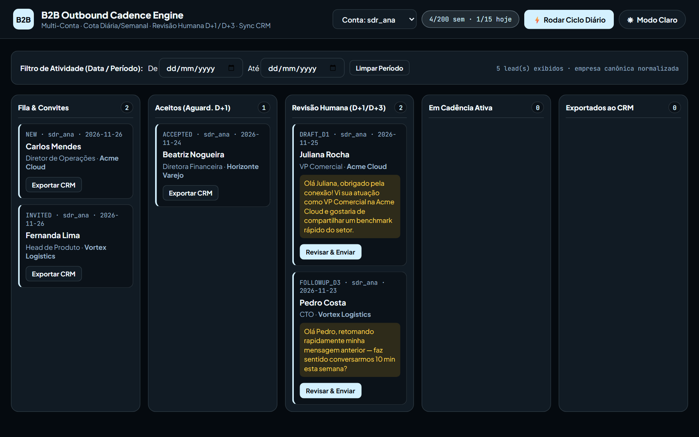

# B2B Outbound Cadence Engine & Kanban Studio



Motor zero-dependências em **Python + SQLite + Web Kanban Studio** para gestão segura de cadências de prospecção B2B outbound multi-conta: aplica **resolução canônica de empresa-alvo**, **cota diária/semanal anti-bloqueio**, filtro de atividade por data/período e revisão humana (*Human-in-the-Loop*) de mensagens **D+1** e **D+3** antes do disparo ou exportação ao CRM.

## Recursos

- **Kanban Web Interativo (`--serve`):** visão completa das colunas (`NEW`/`INVITED` → `ACCEPTED` → `DRAFT_D1`/`FOLLOWUP_D3` → `SENT` → `CRM_SYNCED`), seletor multi-conta (`sdr_ana` / `sdr_lucas`), contador de cota diária/semanal e filtro por data única ou intervalo (`De` / `Até`).
- **Resolução de Empresa-Alvo:** agrupa variações de nomes e subsidiárias em um catálogo canônico (`company_resolver.py`).
- **Rate Limiting Diário:** impede ultrapassar a cota diária de convites por conta.
- **Revisão Humana Obrigatória:** modal para editar e aprovar rascunhos D+1 e D+3 antes de avançar o lead.

## Como Executar

```bash
# 1. Inicia o Kanban & Cadence Studio em http://127.0.0.1:8016 (zero dependências externas!)
python -m src.cli --serve

# 2. Ou executa a simulação rápida via CLI
python -m src.cli --demo

# 3. Executa os testes automatizados
pytest -v
```
